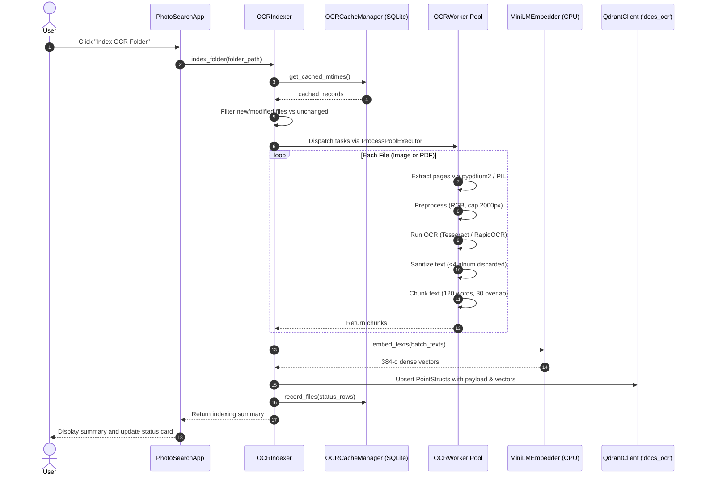
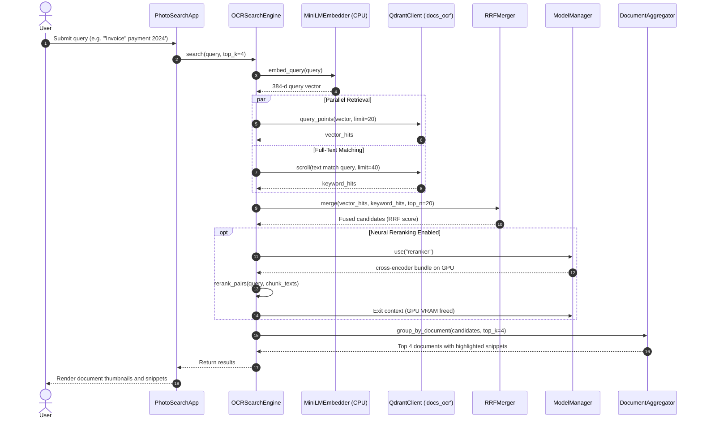

# EmbedEye: System Architecture & Code Structure Documentation

This document provides an in-depth explanation of the Object-Oriented Architecture, Design Patterns, Module Breakdown, and Data Flows in the **EmbedEye Local Photo & OCR Search System**.

---

## 1. System Overview

**EmbedEye** is a local-first, privacy-respecting search platform designed to run efficiently on resource-constrained consumer GPUs (specifically targeted for an **NVIDIA GeForce RTX 3050 Laptop GPU with 4GB VRAM**) while supporting seamless fallback to CPU execution.

The platform provides two primary modes of operation:
1. **Visual Photo Search**:
   - Indexes local photos using a 4-stage pipeline.
   - Extracts 512-dimensional visual vectors using OpenCLIP (`ViT-B-32`).
   - Generates captions and extracts scene text using Florence-2 (`microsoft/Florence-2-base`).
   - Verifies document text using CPU-based RapidOCR without consuming VRAM.
   - Answers natural language and keyword queries by vector similarity + neural cross-encoder reranking (`mixedbread-ai/mxbai-rerank-large-v1`).
2. **OCR-Only Document Search**:
   - Indexes scanned documents, receipts, screenshots, and multi-page PDFs.
   - Extracts text using pluggable OCR engines (RapidOCR on ONNX, native Tesseract v5.5, or Florence-2).
   - Segments extracted text into overlapping chunks and generates 384-dimensional dense vectors using a CPU-based MiniLM model (`sentence-transformers/all-MiniLM-L6-v2`).
   - Stores chunks in a dedicated Qdrant collection (`docs_ocr`) with full-text payload indexes.
   - Retrieves candidates using hybrid dense vector search + keyword full-text matching, merges them via **Reciprocal Rank Fusion (RRF, k=60)**, reranks top chunks with the neural cross-encoder, and groups results by document with highlighted text snippets.

---

## 2. High-Level Architecture Diagram

```mermaid
graph TD
    subgraph UI_Layer ["Presentation Layer (app.py)"]
        App["PhotoSearchApp"]
        TR["ThumbnailRenderer"]
        NEL["NativeExplorerLauncher"]
        SSR["SystemStatusReporter"]
    end

    subgraph Memory_Layer ["Resource & Memory Management (src/gpu_manager.py)"]
        MM["ModelManager (Singleton & Context Manager)"]
        MM -->|"Strict Single-Model VRAM Isolation"| GPU["NVIDIA RTX 3050 4GB GPU / CPU"]
    end

    subgraph Visual_Pipeline ["Visual Photo Pipeline"]
        IDX["Indexer (src/indexer.py)"]
        PMC["PhotoCacheManager (SQLite)"]
        PColl["PhotoCollectionManager (Qdrant 'photos')"]
        SE["SearchEngine (src/search.py)"]
        TQF["TemporalQueryFilter"]
        KPE["KeywordPhraseExtractor"]
        PCER["PhotoCrossEncoderReranker"]
    end

    subgraph OCR_Pipeline ["OCR Document Pipeline"]
        OEF["OCREngineFactory (src/ocr_engine.py)"]
        BaseOCR["BaseOCREngine (Strategy)"]
        Tess["TesseractOCREngine"]
        Rapid["RapidOCREngine"]
        Flor["FlorenceOCREngine"]
        DP["DocumentPreprocessor"]
        TC["TextChunker"]
        MiniLM["MiniLMEmbedder (CPU 384-d)"]
        OIDX["OCRIndexer (src/ocr_indexer.py)"]
        OCache["OCRCacheManager (SQLite)"]
        OColl["OCRCollectionManager (Qdrant 'docs_ocr')"]
        OSE["OCRSearchEngine (src/ocr_search.py)"]
        RRF["RRFMerger"]
        TH["TextHighlighter"]
        CER["CrossEncoderReranker"]
    end

    App --> SE
    App --> OSE
    App --> IDX
    App --> OIDX
    SE --> MM
    IDX --> MM
    OSE --> MM
    OIDX --> OEF
    OEF --> BaseOCR
    BaseOCR <|-- Tess
    BaseOCR <|-- Rapid
    BaseOCR <|-- Flor
```

---

## 3. Object-Oriented Design Patterns Applied

### 3.1. Strategy Pattern (OCR Extraction)
- **Interface**: `BaseOCREngine` in `src/ocr_engine.py` defines an abstract contract `extract_text(image, min_conf)`.
- **Concrete Strategies**:
  - `TesseractOCREngine`: Uses local standalone Tesseract executable (`./models/tesseract/tesseract.exe`) with `eng.traineddata`, grouping word boxes into lines and applying confidence thresholds.
  - `RapidOCREngine`: Uses ONNX Runtime on CPU (0 VRAM) with text line confidence filtering.
  - `FlorenceOCREngine`: Executes Florence-2 `<OCR>` prompt on GPU using `ModelManager.use("florence")`, guaranteeing memory isolation.

### 3.2. Factory Pattern (OCR Engine Construction)
- **Class**: `OCREngineFactory` in `src/ocr_engine.py`.
- **Purpose**: Encapsulates engine selection and instantiation.
- **Method**: `OCREngineFactory.create_engine(engine_name)` creates the appropriate strategy instance and falls back gracefully to `RapidOCREngine` if a requested engine binary is unavailable.

### 3.3. Singleton Pattern
- **`ModelManager`** (`src/gpu_manager.py`): Managed via `get_model_manager()` with thread-safe double-checked locking, ensuring only one manager instance coordinates model loading across the entire process.
- **`MiniLMEmbedder`** (`src/ocr_engine.py`): Reuses loaded tokenizer and `AutoModel` on CPU via `get_minilm_embedder()`.
- **`QdrantClient` Cache** (`src/indexer.py`): Caches `QdrantClient(path=...)` instances per directory path to avoid concurrent file lock errors on SQLite-based QdrantLocal storage.

### 3.4. Context Manager Pattern
- **`ModelManager.use(*names)`**:
  - Enforces RAII (Resource Acquisition Is Initialization).
  - Loads models dynamically into GPU memory, yields them to the caller, and upon context exit, automatically moves modules to CPU, deletes references, triggers garbage collection, and clears CUDA caches.
  - Guarantees that heavy models like Florence-2 never reside on the GPU alongside other models.

### 3.5. Data Transfer Objects (DTO) & Data Access Objects (DAO)
- **DTO**: `OCRDocumentChunk` (`src/ocr_indexer.py`) encapsulates all metadata for a chunk (path, filename, page, chunk index, text, full text length, date, mtime, deterministic UUID5).
- **DAOs**:
  - `OCRCacheManager` (`src/ocr_indexer.py`): Manages SQLite checkpoint persistence in `./data/ocr_indexer_cache.db`.
  - `PhotoCacheManager` (`src/indexer.py`): Manages intermediate 4-stage caching in `./data/indexer_cache.db`.

### 3.6. Facade Pattern
- High-level orchestrators (`SearchEngine`, `OCRSearchEngine`, `PhotoSearchApp`) provide simplified interfaces over complex sub-components (query preprocessing, vector retrieval, full-text filtering, RRF fusion, and cross-encoder reranking).

---

## 4. Module-by-Module Breakdown

### `src/config.py`
- **Role**: Centralized configuration and hardware detection.
- **Key Responsibilities**:
  - Enforces offline cache environment variables (`HF_HOME`, `TORCH_HOME`, `TRANSFORMERS_CACHE`).
  - Detects CUDA availability (`is_cuda_available()`, `get_device()`).
  - Defines vector collection names (`QDRANT_COLLECTION = "photos"`, `OCR_COLLECTION = "docs_ocr"`).
  - Defines batch sizes, confidence thresholds, and model identifiers.

### `src/gpu_manager.py`
- **Role**: Strict GPU VRAM Manager for consumer GPUs (RTX 3050 4GB).
- **Key Classes**:
  - `ModelManager`:
    - `register_loader(name, load_fn, unload_fn)`: Registers lazy loaders.
    - `get_vram_stats()`: Reads allocated, reserved, and free CUDA VRAM in MB.
    - `vram_report()`: Generates detailed hardware and memory summary.
    - `load(name, allow_coexist)`: Loads model enforcing strict coexistence rules (CLIP + Reranker may coexist during search; Florence-2 is strictly isolated).
    - `use(*names)`: Context manager for automatic model cleanup.
    - `use_search()`: Convenience context manager for search time.

### `src/models.py`
- **Role**: Model loading wrappers, image loaders, and text sanitizers.
- **Key Functions**:
  - `safe_load_image(path, max_dimension)`: EXIF orientation, RGB conversion, and thumbnailing without crashing on corrupt files.
  - `clean_ocr_text(text, max_chars)`: Discards noise (under 4 alphanumeric characters, repetitive sequences, unprintable characters).
  - `is_document_or_screenshot(img)`: Fast aspect ratio and luminance analysis to detect text-heavy documents.
  - `load_clip()`, `load_florence()`, `load_reranker()`: Lazy loaders registering to `ModelManager`.
  - `caption_and_ocr_florence()`: Dual-task Florence-2 execution (`<MORE_DETAILED_CAPTION>` and `<OCR>`).
  - `rerank_pairs()`: Neural cross-encoder scoring (`mixedbread-ai/mxbai-rerank-large-v1`).

### `src/ocr_engine.py`
- **Role**: Multi-engine OCR extraction, document preprocessing, text chunking, and dense embedding.
- **Key Classes**:
  - `BaseOCREngine`: Strategy interface.
  - `TesseractOCREngine`: Native Tesseract binary wrapper with line confidence filtering.
  - `RapidOCREngine`: ONNX Runtime CPU engine.
  - `FlorenceOCREngine`: Florence-2 GPU engine with `ModelManager` isolation.
  - `OCREngineFactory`: Factory constructing the requested OCR strategy.
  - `DocumentPreprocessor`: Multi-page PDF renderer (`pypdfium2`) and image preprocessor (EXIF transpose, RGB, resolution cap at 2000px).
  - `TextCleaner`: Sanitizes text and discards sparse noise.
  - `TextChunker`: Sliding window text chunking (default 120 words with 30 words overlap).
  - `MiniLMEmbedder`: CPU-based dense vector embedder (384-d, L2 normalized).

### `src/ocr_indexer.py`
- **Role**: Incremental document indexing pipeline for OCR search.
- **Key Classes**:
  - `OCRDocumentChunk`: Data Transfer Object with deterministic UUID5 generation.
  - `OCRCacheManager`: SQLite checkpoint manager tracking file modification timestamps and indexed chunk counts.
  - `OCRCollectionManager`: Qdrant collection manager configuring 384-d `text` vectors and full-text payload indexes.
  - `OCRWorker`: Encapsulated extraction task executed across multiprocessing pools (`ProcessPoolExecutor`).
  - `OCRIndexer`: Main orchestrator scanning folders, dispatching workers, batch embedding chunks via `MiniLMEmbedder`, and upserting points to Qdrant.

### `src/ocr_search.py`
- **Role**: Hybrid vector + keyword search and neural reranking for OCR documents.
- **Key Classes**:
  - `TextHighlighter`: Regex-based extractor and formatter generating HTML `<mark>` snippet highlights.
  - `RRFMerger`: Reciprocal Rank Fusion combiner fusing dense vector hits and full-text keyword hits ($k=60$).
  - `CrossEncoderReranker`: Neural cross-encoder reranker with strict GPU isolation.
  - `DocumentAggregator`: Groups matching chunks by document `(path, page)` and picks the highest scoring chunk per document.
  - `OCRSearchEngine` (aliased as `OCRSearcher`): Top-level search coordinator.

### `src/indexer.py`
- **Role**: Staged incremental visual photo indexer.
- **Key Classes**:
  - `PhotoMetadataExtractor`: Extracts EXIF capture dates and generates deterministic point IDs.
  - `PhotoCacheManager`: SQLite DAO for caching intermediate stage results (`indexing_cache`).
  - `PhotoCollectionManager`: Manages Qdrant `photos` collection schema and points.
  - `Indexer`: Orchestrates 4 stages:
    - **Stage A**: OpenCLIP visual embedding (batches of 16-32, fp16) -> RAM -> unload.
    - **Stage B**: Florence-2 caption + OCR (batches of 2-4, fp16) -> RAM -> unload.
    - **Stage C**: RapidOCR verification on CPU (0 VRAM).
    - **Stage D**: Batch upsert (64 points) to Qdrant.

### `src/search.py`
- **Role**: Visual search pipeline with temporal query parsing and neural reranking.
- **Key Classes**:
  - `TemporalQueryFilter`: Parses 4-digit years (e.g., `'family vacation 2024'`) and builds Qdrant date range filters.
  - `KeywordPhraseExtractor`: Extracts quoted terms for full-text filtering.
  - `VisualCandidateBuilder`: Constructs candidate dictionaries from vector and text points.
  - `PhotoCrossEncoderReranker`: Formats context prompts (`Caption: ... | Text in image: ... | Date: ...`), executes cross-encoder reranking, and guarantees OpenCLIP rank #1 is preserved in the top 4.
  - `SearchEngine`: High-level visual search coordinator.

### `app.py`
- **Role**: Web user interface built with Gradio.
- **Key Classes**:
  - `ThumbnailRenderer`: Generates thumbnails for image files and PDF document pages.
  - `NativeExplorerLauncher`: Reveals files or opens containing directories in Windows Explorer, macOS Finder, or Linux file managers.
  - `SystemStatusReporter`: Fetches real-time GPU VRAM, active models, and collection statistics.
  - `PhotoSearchApp`: Main application controller building layout components, handling search/indexing callbacks, and binding UI events.

---

## 5. End-to-End Data Flows

### 5.1. OCR Document Indexing Flow



### 5.2. OCR Document Search Flow



---

## 6. Directory Structure Reference

```text
e:/projects/AI image searcher/
├── app.py                      # Main Gradio Web Application (OOP PhotoSearchApp)
├── CODE_STRUCTURE.md           # System Architecture & OOP Documentation (This file)
├── README.md                   # Project overview and setup instructions
├── requirements.txt            # Python dependencies
├── .env                        # Local environment configuration
│
├── src/                        # Core Source Code Modules
│   ├── __init__.py
│   ├── config.py               # Hardware detection & configuration parameters
│   ├── gpu_manager.py          # ModelManager (Strict GPU memory isolation)
│   ├── models.py               # Heavy neural model loaders & inference helpers
│   ├── ocr_engine.py           # BaseOCREngine strategies, preprocessors, MiniLM
│   ├── ocr_indexer.py          # Document chunking, multiprocessing, OCR indexing
│   ├── ocr_search.py           # Hybrid vector/keyword retrieval, RRF, reranking
│   ├── indexer.py              # 4-stage visual photo indexer
│   └── search.py               # Visual search engine & offline temporal filtering
│
├── models/                     # STRICT OFFLINE MODEL WEIGHTS CACHE
│   ├── tesseract/              # Standalone Tesseract v5.5.3 binaries & tessdata
│   │   ├── tesseract.exe
│   │   └── tessdata/
│   │       └── eng.traineddata
│   ├── huggingface/            # Transformers & HuggingFace hub weights
│   ├── open_clip/              # OpenCLIP ViT-B-32 weights
│   ├── reranker/               # mxbai-rerank-large-v1 weights
│   ├── sentence_transformers/  # all-MiniLM-L6-v2 CPU weights
│   └── torch/                  # PyTorch model caches
│
├── data/                       # LOCAL PERSISTENCE STORAGE
│   ├── qdrant/                 # Local Qdrant vector database storage
│   ├── indexer_cache.db        # Visual photo indexing checkpoint SQLite database
│   └── ocr_indexer_cache.db    # OCR document checkpoint SQLite database
│
└── scripts/                    # VERIFICATION & TEST SCRIPTS
    └── verify_ocr_mode.py      # 5-stage automated verification test suite
```

---

## 7. How to Extend the Architecture

1. **Adding a New OCR Engine**:
   - Create a new class subclassing `BaseOCREngine` in `src/ocr_engine.py`.
   - Implement the `extract_text(image: Image.Image, min_conf: float) -> str` method.
   - Register the engine in `OCREngineFactory.create_engine()`.
   - Add the engine name to the CLI choices in `src/ocr_indexer.py` and the dropdown in `app.py`.

2. **Adding a New Visual Embedding Model**:
   - Implement the loader and unloader in `src/models.py`.
   - Register the loader in `src/gpu_manager.py` using `manager.register_loader(...)`.
   - Update `src/indexer.py` (Stage A) to invoke the new embedding model.

3. **Customizing Reranker Fusion Weights**:
   - Adjust constant $k$ in `RRFMerger(k=...)` in `src/ocr_search.py` to balance the weight between rank-1 items and lower-ranked items.
